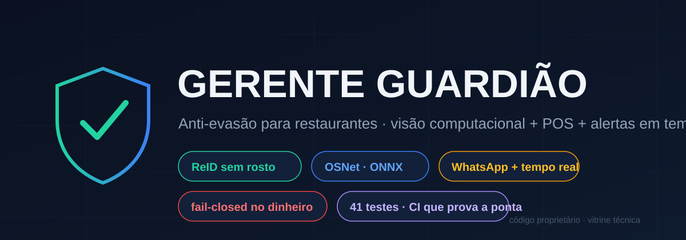
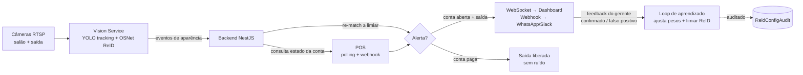
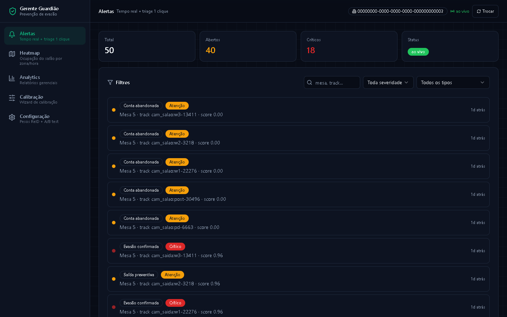
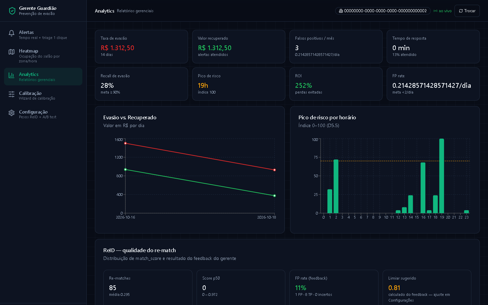
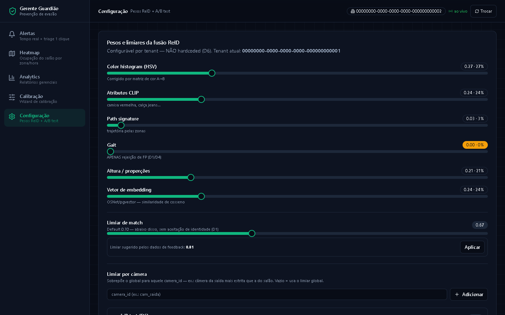
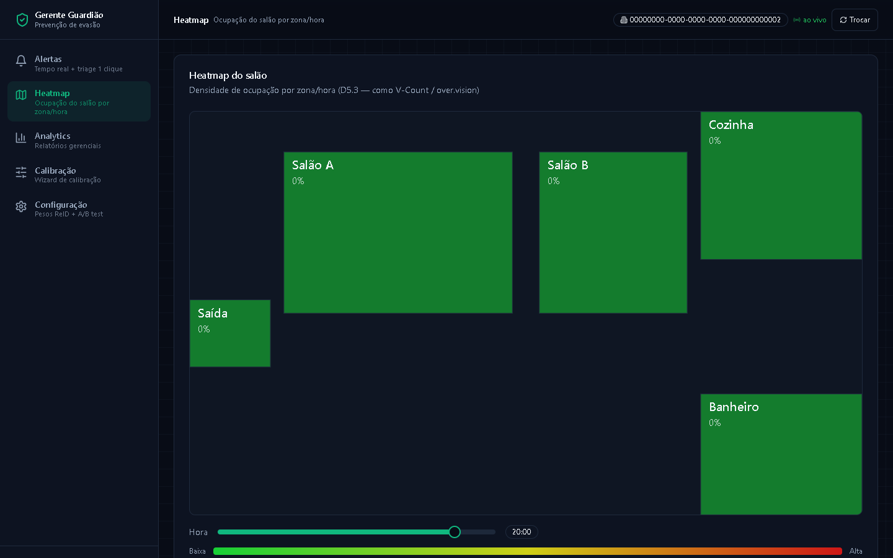

### Anti-evasão inteligente para restaurantes — visão computacional + POS + alertas em tempo real


*Detecta quando um cliente tenta sair sem pagar — associando pessoas a mesas por aparência (sem reconhecimento facial), cruzando com o estado da conta no POS e alertando o gerente em segundos, no dashboard e no WhatsApp.*

> ⚠️ **O código-fonte é proprietário.** Este repositório é uma vitrine técnica: arquitetura, decisões de engenharia e evidências de produção.

---

## O problema

Restaurantes perdem receita com saídas sem pagamento — intencionais ou não. As soluções existentes caem em dois extremos: câmeras que só gravam (evidência tardia) ou reconhecimento facial (caro, invasivo, atrito com a LGPD).

## A solução

Um pipeline que roda **em tempo real** sobre as câmeras que o restaurante já tem:



**Cinco decisões de engenharia que definem o sistema:**

| Decisão | Por quê |
|---|---|
| **ReID por aparência, sem rosto** | Vetor OSNet (512d) + histograma de cor + altura + assinatura de trajetória. Sem biometria facial → LGPD-friendly por design |
| **POS como fonte de verdade, fail-closed** | POS indisponível = trata como conta em aberto (alerta preventivo "confirme com o garçom"). Nunca libera por dúvida |
| **Limiar por câmera** | A câmera da saída pode ser mais estrita que a do salão — `camera_thresholds` por tenant, com fallback global |
| **Aprendizado com freio** | Feedback do gerente ajusta pesos/limiar, mas a sugestão é conservadora: ponderada por volume de evidência, passo máximo ±0.15 por ciclo, tudo auditado |
| **Alarme não vira spam** | Deduplicação **persistida** por mesa+tipo (sobrevive a restart), retry com backoff (5xx/rede), sem retry em 4xx — canal de alarme confiável |

## ReID real, medido — não marketing

Extração com **OSNet x1_0** treinado em MSMT17, exportado para ONNX (batch dinâmico), rodando no pipeline de produção:

| Modelo | Mesma pessoa (cos) | Pessoa diferente (cos) | Separação |
|---|---|---|---|
| **OSNet x1_0 MSMT17** (em uso) | 1.000 | 0.588 | **0.412** |
| OSNet x0.25 MSMT17 | 1.000 | 0.501 | 0.499 |
| OSNet x1_0 ImageNet | 1.000 | 0.757 | 0.243 ← pesos errados, provado por medição |

*Medição executada contra os modelos ONNX de produção: pior caso de variação de posição para a mesma pessoa vs. melhor caso entre pessoas com aparências distintas.*

O pipeline valida estabilidade temporal do descritor ao longo do track (pior cos > 0.85 em sequência de vídeo — medido 1.000) e separação entre pessoas — testado com sequência de frames real passando pelo `RTSPCapture` de produção, não com mocks.

## Qualidade como processo

* **31 specs Jest** de comportamento no backend — retry de webhook, dedup persistido através de restart, paginação, fail-closed do POS
* **10 specs pytest** na visão — descritor ONNX real no pipeline, estabilidade temporal, captura multi-backend
* **Smoke E2E** com 12 checks + **smoke WebSocket** com 7 checks — a cadeia inteira provada contra a stack real
* **CI que prova a ponta**: Docker Compose sobe Postgres+Redis+backend, o container de visão roda `--simulate`, e o gate **asserta que a simulação gerou um alerta real consultável via API** — não apenas "o container saiu com exit 0"

## O produto em operação

| Triagem de alertas em tempo real | Analytics gerencial |
|---|---|
|  |  |

**Tela de alertas:** severidade, tipo (Evasão confirmada / Saída preventiva / Conta abandonada), mesa, track e score de re-match — com WebSocket "ao vivo" e triagem de 1 clique.

**Analytics:** taxa de evasão em R$, ROI do sistema, recall, FP rate por feedback do gerente, pico de risco por horário e qualidade do ReID — incluindo **limiar sugerido calculado dos dados reais** de feedback.

**Configuração ReID ao vivo:** pesos de fusão por sinal, limiar de match, sugestão calculada dos dados e limiar por câmera — tudo por tenant, tudo auditado:



**Mapa de zonas:** calibração visual das áreas monitoradas (salões, cozinha, saída, banheiro) com densidade de ocupação por hora — é o que permite associar "quem estava onde" ao cruzar a saída:



## Governança do loop gerente → config

```
medir (métricas ReID, distribuição de scores, FP rate)
  → sugerir (limiar conservador baseado em evidência)
  → aplicar (1 clique na UI)
  → auditar (ReidConfigAudit: quem, quando, antes→depois, origem manual/feedback)
  → reverter (rollback de config com 1 clique — o desfazer também é auditado)
  → avisar drift (banner proativo quando FP rate passa do limiar operacional)
```

## Stack

| Camada | Tecnologia |
|---|---|
| Backend | NestJS, TypeScript, Prisma, PostgreSQL + **pgvector**, Redis |
| Visão | Python, OpenCV, ONNX Runtime, OSNet x1_0, tracking multi-câmera |
| Tempo real | Socket.IO com ACK persistido |
| Dashboard | Next.js, React, Recharts — paginação, live alerts, auditoria visual |
| Notificações | Webhook genérico (Slack/n8n/Twilio) + bridge WhatsApp via CDP |
| Infra | Docker Compose, GitHub Actions (E2E containerizado) |

📐 **[Arquitetura detalhada →](docs/ARQUITETURA.md)** — fluxo de decisão, fusão ReID, fail-closed, governança do aprendizado e canal de alerta.

---

*Projeto proprietário em operação. Documentação técnica detalhada e demonstração disponíveis sob NDA.*
